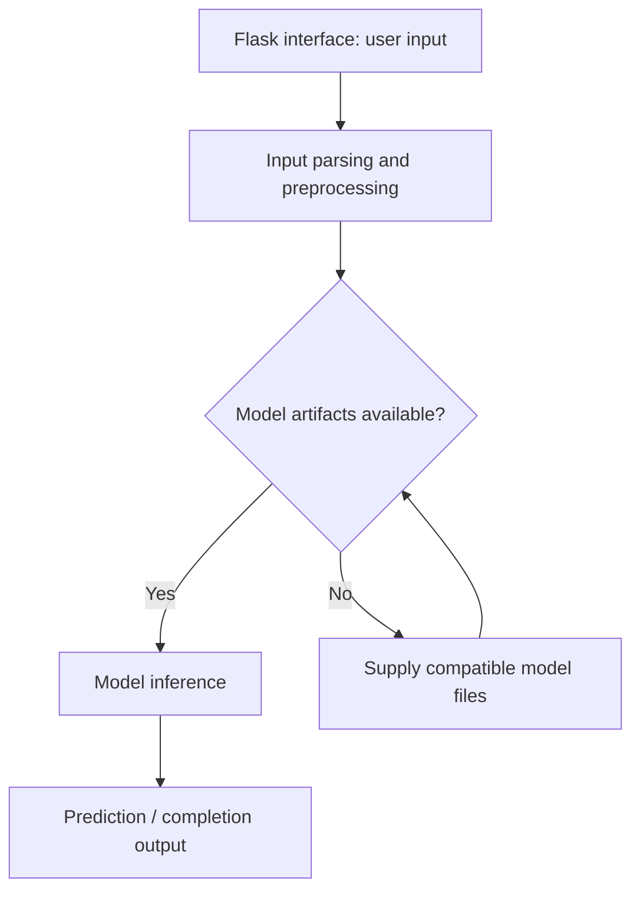

# Student Exam Performance Prediction

Flask student-performance prediction project with data-processing, model-training, and inference pipeline components.

## Project focus

Flask application. The sections below separate the runnable entry point, source layout, prerequisites, and verification path.

## Architecture



## Repository structure

| Path | Purpose |
| --- | --- |
| [`.ebextensions/`](.ebextensions) | Project-specific source, resources, or learning material. |
| [`app.py`](app.py) | Application entry point or route definitions. |
| [`application.py`](application.py) | Python application helper or learning example. |
| [`artifacts/`](artifacts) | Project-specific source, resources, or learning material. |
| [`catboost_info/`](catboost_info) | Project-specific source, resources, or learning material. |
| [`notebook/`](notebook) | Project-specific source, resources, or learning material. |
| [`requirements.txt`](requirements.txt) | Python dependency manifest. |
| [`setup.py`](setup.py) | Python application helper or learning example. |
| [`src/`](src) | Application or exercise source code. |
| [`templates/`](templates) | Server-rendered HTML templates. |

## Getting started

```bash
git clone https://github.com/Raimal-Raja/Student-Exam-Performance-Indicator.git
cd Student-Exam-Performance-Indicator
```

```bash
python -m venv .venv
source .venv/bin/activate
```

On Windows PowerShell, activate the environment with `.venv\Scripts\Activate.ps1` instead.

```bash
python -m pip install -r requirements.txt
```

```bash
python app.py
```

## Verification

Use the setup commands and inspect the selected interface, example, or notebook with known inputs. This documentation review checks repository paths and dependency declarations; it does not claim fresh end-to-end execution or model-quality measurements.

## Contributing

Include reproduction steps, the affected path, expected behavior, and the checks you ran. Keep credentials, generated environments, and unnecessary build artifacts out of commits.

## License

No top-level license file is currently tracked. Check reuse permissions with the repository owner.
